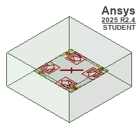
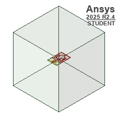
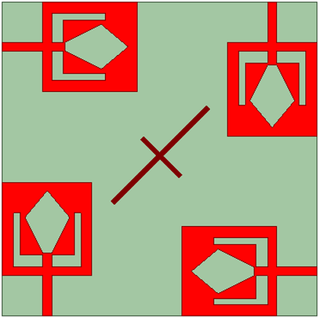
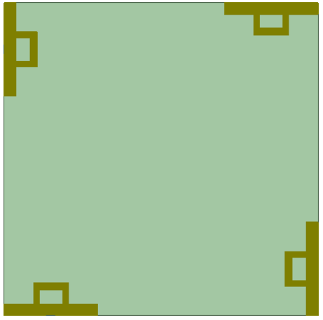

# Sub-6 GHz UWB MIMO Antenna

An Ansys HFSS antenna-design project containing a four-port MIMO model and a single-element companion design. The repository provides the native project directly, with geometry previews and documentation for inspecting and reproducing the setup locally.

## Design previews

| MIMO design | Single element |
| --- | --- |
|  |  |

These are the previews embedded in the original supplied project, not newly generated simulation results. The original Student-edition markings are retained.

## Detailed geometry views

These additional front and rear geometry images were supplied by the project author. They supplement the original previews above and are not measured results or photographs of fabricated antennas.

### Single element

| Front geometry | Rear geometry |
| --- | --- |
|  |  |

### Four-port MIMO

| Front geometry | Rear geometry |
| --- | --- |
|  |  |

## Project configuration

The following values were read from the project file; they are settings, not validated performance claims.

| Item | Stored configuration |
| --- | --- |
| Project format | Ansys Electronics Desktop, Student 2025 R2 |
| Designs | `MIMO_final` and `single_ele` |
| Solution type | HFSS Terminal Network |
| Adaptive solution frequency | 5 GHz |
| Frequency sweep | 1–20 GHz, 0.01 GHz linear step, Interpolating |
| Project-defined dielectric | Melinex_PET: relative permittivity 2.9; loss tangent 0.06 |
| Saved analysis definitions | S-parameter reports and MIMO output variables including ECC, DG, MEG, TARC, and CCL |

The configured sweep extends beyond 6 GHz. Neither that sweep nor the project title establishes usable bandwidth, matching, isolation, efficiency, or gain. The saved output-variable expressions have not been independently checked.

## Open the project

1. Obtain a compatible Ansys Electronics Desktop installation with HFSS and an appropriate license. The saved file identifies Student 2025 R2; compatibility with other versions or editions is unverified.
2. Download [`single_element_and_MIMO.aedt`](single_element_and_MIMO.aedt) using GitHub's **Download raw file** button, then open it in Electronics Desktop. No ZIP extraction is needed.
3. Inspect both designs, material assignments, boundaries, excitations, and analysis settings before solving.
4. Validate and solve locally to regenerate results. Separate solver-result folders are not included; saved report definitions may need a fresh solve before displaying data.

## Contents

```text
single_element_and_MIMO.aedt  Native HFSS project
mimo-preview.jpg             Original embedded MIMO geometry preview
single-element-preview.jpg   Original embedded single-element preview
NOTICES.md                   Provenance and publication notes
.gitignore                   Generated-output and private-file exclusions
.gitattributes               Preserve native-project and image bytes
```

## Verification status

The native AEDT file is unchanged from the previously reviewed public copy. Its core project and reference block match the supplied source byte-for-byte; the appended preview cache was previously removed. The images above were extracted unchanged from that original cache and visually checked. The redundant ZIP has been removed from the current repository file list, while the native design remains directly available.

**The project was not opened in HFSS and no simulation was run during repository preparation.** These static checks do not establish that the file loads successfully, that the design converges, or that the antenna meets any specification.

No open-source license was inferred or added. See [NOTICES.md](NOTICES.md).
